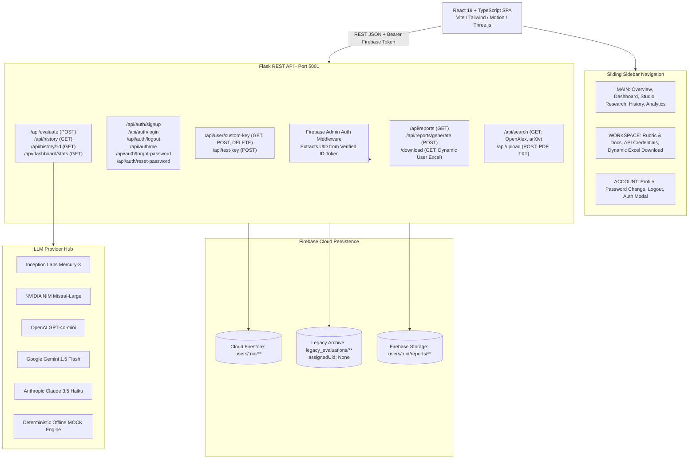

# ABSTRIQ 3.1 — Authentication-First Academic Research Evaluator & SaaS Intelligence Studio

> **Topic Domain:** Computer Science &amp; Artificial Intelligence Research Abstracts  
> **Evaluation Framework:** 20-Mark Academic Rubric (5 Criteria &times; 0–4 Levels)  
> **Product Architecture:** Two-Tier SaaS: Public Website (Overview, Methodology, Public Docs, Static Demo) vs. Private Workspace (Dashboard, Studio, Research, History, Analytics, Custom Keys, Dynamic Excel)  
> **Frontend Stack:** React 19, TypeScript, Vite 6, Tailwind CSS, Motion for React, Three.js, React Three Fiber, Lucide React, Firebase Client SDK  
> **Backend Stack:** Python 3.9/3.11+, Flask 3, Firebase Admin SDK, Cloud Firestore, openpyxl, cryptography (Fernet), pypdf, requests, python-dotenv  
> **Primary LLM Engine:** Inception Labs (`mercury-3`) &bull; NVIDIA NIM (`mistral-large`) &bull; OpenAI &bull; Gemini &bull; Anthropic &bull; Deterministic Offline MOCK Heuristic  
> **Security Architecture:** Firebase Authentication (Email/Password ONLY), Central Auth Route Guards, Dual-Layer UID Enforcement (Firestore Rules + Flask Backend), AES-Fernet Credential Vault, Dynamic UID-Isolated Excel Reporting  

---

## 1. Product Architecture: Public Website vs. Private Workspace

ABSTRIQ 3.1 operates as an authentication-first multi-user SaaS platform:

```mermaid
flowchart TD
    Visitor([Public Visitor]) --> PubSite[Tier 1: Public Website<br/>No Login Required]
    PubSite --> P1[Cinematic Hero & 3D Network Visualization]
    PubSite --> P2[5-Criteria Rubric Framework Overview]
    PubSite --> P3[5-Stage Deterministic Pipeline Guide]
    PubSite --> P4[Interactive Public Demonstration Preview<br/>Static Peer-Reviewed Demo Data]
    PubSite --> P5[Public Documentation & Viva Script Modal]
    PubSite --> P6[Sign In & Account Registration Modals]

    Researcher([Authenticated Researcher]) --> PrivApp[Tier 2: Private Application Workspace<br/>Firebase Auth Required]
    PrivApp --> W1[Executive Dashboard & Clean New Account Onboarding]
    PrivApp --> W2[Evaluation Studio: Direct Paste, OpenAlex/arXiv, PDF/TXT Upload]
    PrivApp --> W3[Research Discovery: Live Literature Search & Import]
    PrivApp --> W4[Evaluation History: Firestore Persisted Records]
    PrivApp --> W5[Score Analytics: Criterion Distribution Graphs]
    PrivApp --> W6[API Credentials: AES-Fernet Encrypted Custom Key Vault]
    PrivApp --> W7[Dynamic Excel Download: Workbooks Filtered Strictly by User UID]
```



### Public vs. Private Access Control Matrix

| Resource | Public Visitors | Authenticated Researchers | Security Enforcement |
|:---|:---:|:---:|:---|
| **Overview & Landing Hero** | ✅ Yes | ✅ Yes | Public route (`/`) |
| **5-Stage Methodology Guide** | ✅ Yes | ✅ Yes | Public modal & page |
| **Public Interactive Demo** | ✅ Yes | ✅ Yes | Static demo data (`/api/demo/sample`) |
| **Public Demo Evaluator** | ✅ Yes | ✅ Yes | Rate-limited, max 350 words, mock heuristic (`/api/demo/evaluate`) |
| **Executive Dashboard** | ❌ Blocked | ✅ Yes | Auth Guard + HTTP 401 on `/api/dashboard/stats` |
| **Evaluation Studio** | ❌ Blocked | ✅ Yes | Auth Guard + HTTP 401 on `/api/evaluate` |
| **Research Discovery Corpus** | ❌ Blocked | ✅ Yes | Auth Guard + HTTP 401 on `/api/search` |
| **Document File Upload** | ❌ Blocked | ✅ Yes | Auth Guard + HTTP 401 on `/api/upload` |
| **Evaluation History Logs** | ❌ Blocked | ✅ Yes | Auth Guard + HTTP 401 on `/api/history` |
| **Excel Workbook Download** | ❌ Blocked | ✅ Yes | Auth Guard + HTTP 401 on `/download` |
| **Custom API Key Vault** | ❌ Blocked | ✅ Yes | Auth Guard + HTTP 401 on `/api/user/custom-key` |
| **Private Workspace Sidebar** | ❌ Hidden | ✅ Visible | Rendered only when authenticated |

---

## 2. Multi-User Architecture & Firebase Infrastructure



---

### REST API Endpoints

| Endpoint | Method | Auth Required | Description |
| :--- | :---: | :---: | :--- |
| `/api/config` | `GET` | No | Returns system configuration, active LLM model, prompt versions, thresholds, and rubric. |
| `/api/auth/signup` | `POST` | No | Registers user account with PBKDF2:SHA256 password hash; issues session token. |
| `/api/auth/login` | `POST` | No | Authenticates user via email/username + password; returns session token. |
| `/api/auth/logout` | `POST` | Yes | Revokes active session token in SQLite and clears cookies. |
| `/api/auth/me` | `GET` | Yes | Returns authenticated user profile and active session state. |
| `/api/auth/profile` | `PUT` | Yes | Updates user's full name, institution, and affiliation details. |
| `/api/auth/password` | `PUT` | Yes | Verifies current password and updates to new password. |
| `/api/auth/forgot-password` | `POST` | No | Generates cryptographically secure single-use password reset token. |
| `/api/auth/reset-password` | `POST` | No | Verifies reset token, applies new password, and revokes prior sessions. |
| `/api/user/custom-key` | `GET` | Yes | Returns masked API key and provider configuration for authenticated user. |
| `/api/user/custom-key` | `POST` | Yes | Securely encrypts user's custom API key at rest using per-user AES-Fernet cipher. |
| `/api/user/custom-key` | `DELETE` | Yes | Removes user's encrypted custom key and reverts to server defaults. |
| `/api/test-key` | `POST` | Optional | Tests live credentials against provider with latency benchmark. |
| `/api/evaluate` | `POST` | Optional | Executes 5-stage abstract evaluation pipeline; links to user if authenticated. |
| `/api/search` | `GET` | No | Literature search across OpenAlex & arXiv with token reconstruction. |
| `/api/upload` | `POST` | No | Uploads `.pdf`, `.txt`, or `.md` and extracts the abstract section. |
| `/api/history` | `GET` | Optional | Returns evaluation records isolated by authenticated user (or benchmark runs). |
| `/download` | `GET` | No | Downloads the live Excel workbook (`results.xlsx`) containing all three sheets. |

---

## 3. Database Schema & Security Architecture

The database is powered by SQLite at `data/abstriq.db` with thread-safe connection pooling, WAL mode, and cascading foreign keys.

### SQLite Tables

#### 1. `users` Table
```sql
CREATE TABLE users (
    id INTEGER PRIMARY KEY AUTOINCREMENT,
    email TEXT UNIQUE NOT NULL,
    username TEXT UNIQUE NOT NULL,
    password_hash TEXT NOT NULL,
    full_name TEXT DEFAULT '',
    institution TEXT DEFAULT '',
    role TEXT DEFAULT 'researcher',
    created_at TEXT NOT NULL,
    updated_at TEXT NOT NULL,
    reset_token TEXT,
    reset_token_expires_at TEXT
);
```

#### 2. `sessions` Table
```sql
CREATE TABLE sessions (
    id INTEGER PRIMARY KEY AUTOINCREMENT,
    user_id INTEGER NOT NULL,
    token TEXT UNIQUE NOT NULL,
    created_at TEXT NOT NULL,
    expires_at TEXT NOT NULL,
    user_agent TEXT DEFAULT '',
    ip_address TEXT DEFAULT '',
    FOREIGN KEY (user_id) REFERENCES users(id) ON DELETE CASCADE
);
```

#### 3. `user_api_keys` Table
```sql
CREATE TABLE user_api_keys (
    id INTEGER PRIMARY KEY AUTOINCREMENT,
    user_id INTEGER NOT NULL UNIQUE,
    provider TEXT NOT NULL,
    model TEXT NOT NULL,
    encrypted_key TEXT NOT NULL,
    created_at TEXT NOT NULL,
    updated_at TEXT NOT NULL,
    FOREIGN KEY (user_id) REFERENCES users(id) ON DELETE CASCADE
);
```

#### 4. `evaluations` Table
```sql
CREATE TABLE evaluations (
    id TEXT PRIMARY KEY,
    user_id INTEGER,
    timestamp TEXT NOT NULL,
    source TEXT DEFAULT 'manual',
    title TEXT DEFAULT 'Untitled Paper',
    prompt_version TEXT DEFAULT 'score_v3',
    model TEXT DEFAULT '',
    status TEXT DEFAULT 'completed',
    word_count INTEGER DEFAULT 0,
    score_purpose INTEGER DEFAULT 0,
    score_method INTEGER DEFAULT 0,
    score_results INTEGER DEFAULT 0,
    score_conclusion INTEGER DEFAULT 0,
    score_clarity INTEGER DEFAULT 0,
    total INTEGER DEFAULT 0,
    warnings TEXT DEFAULT 'none',
    suggestions_json TEXT DEFAULT '[]',
    seconds REAL DEFAULT 0.0,
    abstract TEXT DEFAULT '',
    FOREIGN KEY (user_id) REFERENCES users(id) ON DELETE SET NULL
);
```

---

### API Key Security Architecture

- **Never Logged**: API keys are filtered from server logs, terminal output, and error responses.
- **Never in URLs**: All credential exchanges use HTTP POST payloads over encrypted transports.
- **Never Plaintext at Rest**: Custom keys are encrypted using symmetric AES-Fernet (`cryptography.fernet.Fernet`).
- **Per-User Key Derivation**: The encryption key for each user is generated via HMAC-SHA256:
  ```text
  UserFernetKey = base64url( HMAC-SHA256( SECRET_KEY, "abstriq-user-key-salt-" + user_id ) )
  ```
  Even if the database is extracted, no single user's key can decrypt another user's credentials.
- **Masked Retrieval**: `GET /api/user/custom-key` returns masked format `sk-p...9999` and never transmits raw secrets to the browser.
- **Ephemeral Guest Fallback**: If an unauthenticated guest enters a temporary key, it is held strictly in browser `sessionStorage` (purged upon closing the tab) rather than `localStorage`.

---

## 4. Frontend Sliding Sidebar Navigation & UI Architecture

The frontend uses a collapsible sliding sidebar (`Sidebar.tsx`) with a synchronized top bar (`TopHeader.tsx`):

- **Sidebar Structure**:
  - **MAIN**: Overview, Dashboard, Evaluation Studio, Research Discovery, Evaluation History, Analytics.
  - **WORKSPACE**: Rubric &amp; Documentation, API Credentials, Download Excel Workbook.
  - **ACCOUNT**: Researcher Profile, Password Management, Sign In / Sign Out.
- **Responsive Layout**:
  - Desktop: Collapses between expanded (`w-64` / `pl-64`) and compact icon mode (`w-20` / `pl-20`). The layout area dynamically shifts without overlapping.
  - Mobile: Slide-over drawer with backdrop blur overlay, keyboard `Escape` dismiss, and touch drawer gestures.
  - Preferences: Saved in browser `localStorage` (`abstriq_sidebar_collapsed`).

---

## 5. Five Animation Layers

1. **Generative Particle Network ([`GenerativeCanvasBackground.tsx`](frontend/src/components/animations/GenerativeCanvasBackground.tsx)):**
   - High-performance canvas node network with dynamic Euclidean distance calculation.
   - Interactive cursor gravitation and repulsion fields.
   - Automatically pauses animation loop when tab is hidden (`document.hidden`).
   - Respects `prefers-reduced-motion` with static calm constellation.
2. **Ambient Emerald Light Fields:**
   - Soft pulsing radial gradient orbs creating depth behind dashboard analytics and studio inputs.
3. **Interactive 3D Scientific Visualization ([`HeroResearchScene.tsx`](frontend/src/components/animations/HeroResearchScene.tsx)):**
   - Built with **Three.js** and **React Three Fiber (R3F)** on the Landing Page.
   - Dual orbital scientific rings, central icosahedron, and floating data nodes with mouse parallax.
4. **Scroll-Based Section Reveals:**
   - Coordinated entrances, staggered card reveals, and smooth page transitions powered by `motion/react`.
5. **Micro-Interactions:**
   - SVG animated score rings ([`ScoreMeter.tsx`](frontend/src/components/charts/ScoreMeter.tsx)), criterion breakdown bars, tooltip pills, and active status badges.

---

## 6. Environment Variables

Create a `.env` file in the project root:

```ini
# Server Port & Secret Key
PORT=5001
SECRET_KEY=replace-with-a-strong-random-secret-key-32-chars

# LLM Provider Configuration (mock, inception, nvidia, openai, gemini, anthropic)
LLM_PROVIDER=inception
LLM_API_KEY=your_primary_api_key_here
LLM_MODEL=mercury-3

# Evaluation & Storage Configuration
LOW_SCORE_THRESHOLD=10
DATABASE_PATH=data/abstriq.db
RESULTS_FILE=data/results.xlsx

# Session Durations
SESSION_EXPIRE_DAYS=14
RESET_TOKEN_EXPIRE_MINUTES=60
```

---

## 7. Development Setup & Launch Instructions

### Prerequisites
- Python 3.9+ (Python 3.9/3.11 tested)
- Node.js 18+ and npm 9+

### 1. Install Dependencies
```bash
# Backend dependencies
pip install -r requirements.txt

# Frontend dependencies
cd frontend
npm install
cd ..
```

### 2. Run Test Suite
```bash
# Execute all 19 pytest unit & integration tests
python3 -m pytest tests/
```

### 3. Build Production Frontend
```bash
cd frontend
npm run build
cd ..
```

### 4. Launch Application
```bash
# Run Flask backend on port 5001 (serves compiled React frontend automatically)
python3 app.py
```
Open **`http://localhost:5001`** in your browser.

For frontend hot-reloading during development:
```bash
cd frontend && npm run dev
```
Open **`http://localhost:5173`** (proxied to Flask backend).
